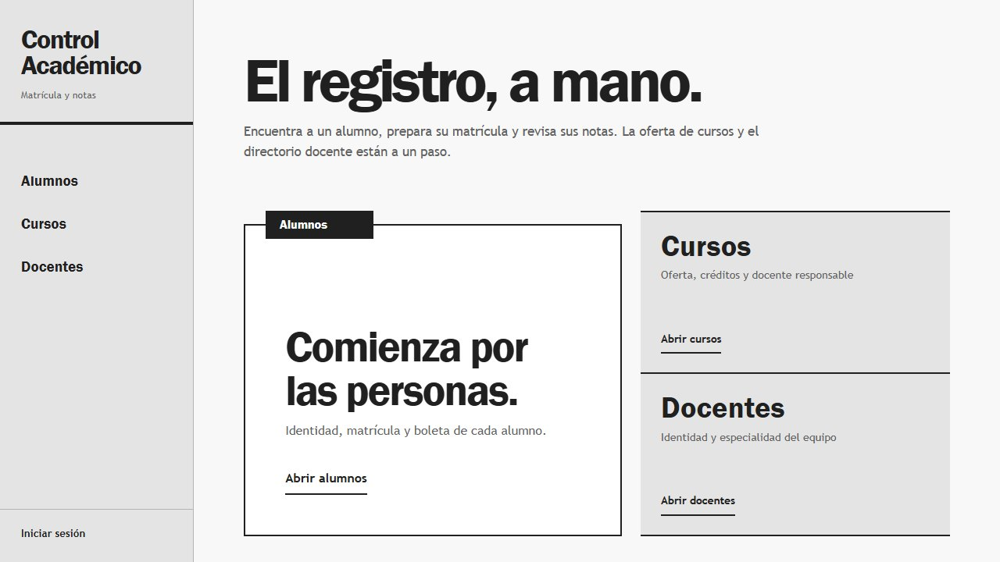
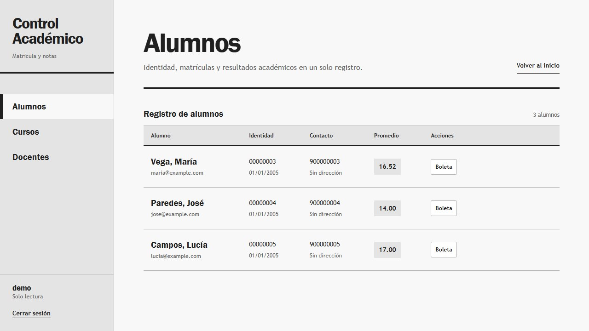
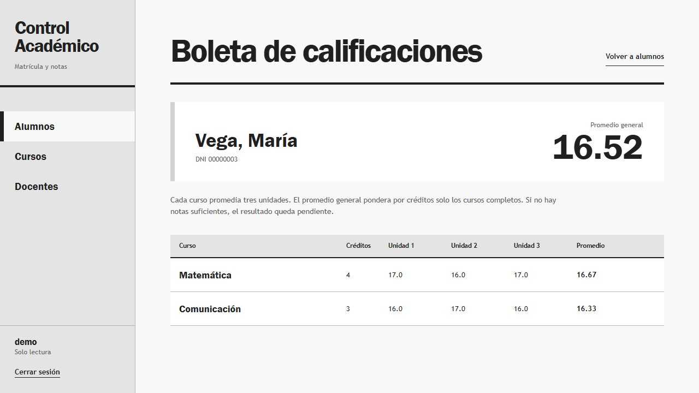

# Control Académico

Un sistema de matrícula y calificaciones construido para recorrer el trabajo académico de principio a fin: del registro de un alumno a su boleta. Este repositorio contiene **la aplicación completa del MVP**; la instancia pública ejecuta el mismo código con datos ficticios y permisos de consulta.

**[Abrir la demo](https://matricula-springboot.onrender.com)** · **[Ver el recorrido en video](docs/portfolio/recorrido.webm)** · **[Ejecutar en local](#ejecución-local)**

[](https://matricula-springboot.onrender.com)

> **Para entrar:** usuario `demo`, clave `demo123`. El servicio gratuito puede tardar uno o dos minutos en despertar tras un periodo de inactividad.

## El recorrido

| Etapa | Lo que permite hacer |
| --- | --- |
| Personas | Registrar y consultar alumnos y docentes, con validaciones en sus formularios. |
| Oferta | Crear cursos con créditos y asignarles un docente. |
| Matrícula | Seleccionar los cursos de cada alumno y revisar su inscripción. |
| Evaluación | Cargar o corregir las notas de tres unidades, de 0 a 20. Las notas pueden quedar pendientes. |
| Boleta | Consultar notas por curso y el promedio general ponderado por créditos. |

La demo pública permite **explorar listados y boletas**. Para probar altas, cambios y matrículas, ejecuta el proyecto localmente con una cuenta administradora.

<details>
<summary>Ver cómo se calculan las notas y qué cambios protege el sistema</summary>

El promedio de un curso es la media de sus tres unidades. Aparece como «Pendiente» hasta que estén completas. El promedio general incluye solo cursos completos y pondera cada promedio por los créditos del curso.

Para conservar la coherencia de los datos, el sistema impide eliminar alumnos con matrículas, cursos con alumnos matriculados y docentes con cursos asignados. Una matrícula con notas no se puede retirar hasta borrar sus calificaciones.

</details>

### Una vista más cercana

| Alumnos | Boleta |
| --- | --- |
| [](docs/portfolio/alumnos.jpg) | [](docs/portfolio/boleta.jpg) |

[Ver la boleta en móvil](docs/portfolio/boleta-movil.jpg) · [Ver el recorrido grabado](docs/portfolio/recorrido.webm)

## Stack y estructura

| Capa | Tecnología |
| --- | --- |
| Aplicación | Java 21, Spring Boot 3.5, Spring MVC |
| Vistas | Thymeleaf, CSS propio, Bootstrap |
| Datos | Spring Data JPA, H2 en memoria para la demo; controlador JDBC de PostgreSQL incluido |
| Acceso | Spring Security: lector y administrador |
| Construcción | Maven Wrapper, Docker multietapa |
| Pruebas | JUnit, Spring Boot Test y MockMvc |

El proyecto usa vistas renderizadas en el servidor. `Alumno`, `Curso` y `Docente` son los registros principales; la relación entre alumno y curso conserva la matrícula y sus tres calificaciones. Los datos de ejemplo se cargan al iniciar el perfil `demo`.

## Ejecución local

Necesitas **JDK 21 o superior** y conexión a Internet en la primera ejecución para descargar dependencias. Desde la raíz del repositorio, en PowerShell:

```powershell
$env:DEMO_ADMIN_PASSWORD = 'elige-una-clave-local'
.\mvnw.cmd spring-boot:run
```

Abre [http://localhost:8080](http://localhost:8080). Usa `demo` / `demo123` para consultar, o `admin-demo` / el valor de `DEMO_ADMIN_PASSWORD` para editar. Si no defines esa variable, la cuenta administradora no se crea. Si Java 21 no es tu versión activa, configura `JAVA_HOME` antes de iniciar Maven.

Para ejecutar las pruebas:

```powershell
.\mvnw.cmd test
```

### Modo público de solo lectura

La instancia desplegada usa estas variables:

```text
SPRING_PROFILES_ACTIVE=demo
DEMO_PUBLIC_READ_ONLY=true
```

`DEMO_PUBLIC_READ_ONLY=true` impide crear la cuenta administradora incluso si se configurara una contraseña por error. La base H2 vive en memoria: **los datos ficticios se restauran al reiniciar** y no se necesita un servidor de base de datos para esta demo. El puerto se toma de `PORT` cuando lo proporciona el hosting; en local es `8080`.

También puedes reproducir ese modo con Docker:

```powershell
docker build -t control-academico-demo .
docker run --rm -p 10000:10000 -e PORT=10000 -e SPRING_PROFILES_ACTIVE=demo -e DEMO_PUBLIC_READ_ONLY=true control-academico-demo
```

Después abre [http://localhost:10000](http://localhost:10000). No introduzcas datos reales en el perfil `demo`.

## Alcance y uso del código

Este es un **MVP de portfolio**, no un sistema preparado para almacenar expedientes reales de forma persistente. No incluye periodos académicos históricos ni exportación de boletas. La instancia pública está limitada a consulta y se restablece al reiniciar.

El repositorio es público para mostrar el trabajo, pero **no incluye una licencia que conceda permisos generales para reutilizar, modificar o redistribuir el código original**. Los componentes de terceros conservan sus propias licencias. Si necesitas usar partes del proyecto fuera de las funciones de visualización y fork de GitHub, contacta al autor para acordar los términos.

---

Proyecto personal de [AlexDeRivia](https://github.com/AlexDeRivia). [Explorar la demo](https://matricula-springboot.onrender.com).
